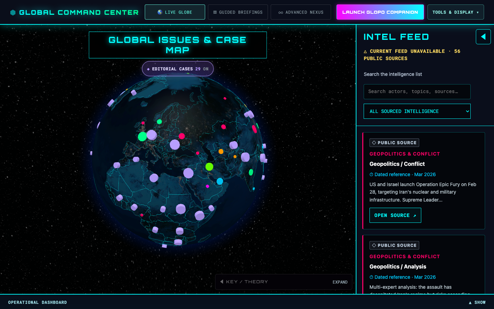
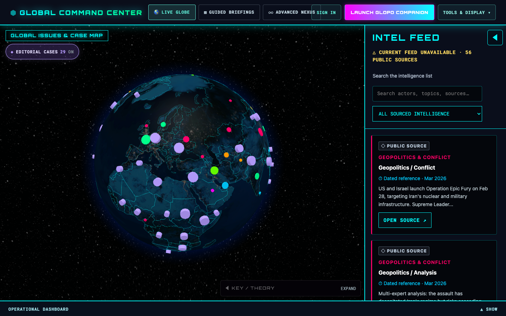
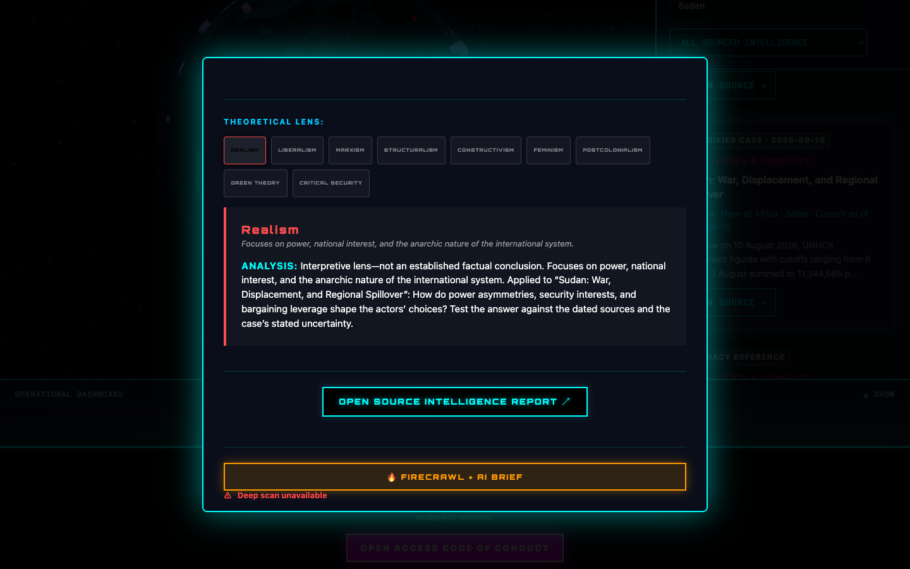
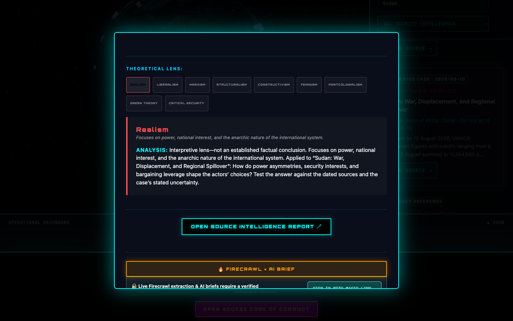
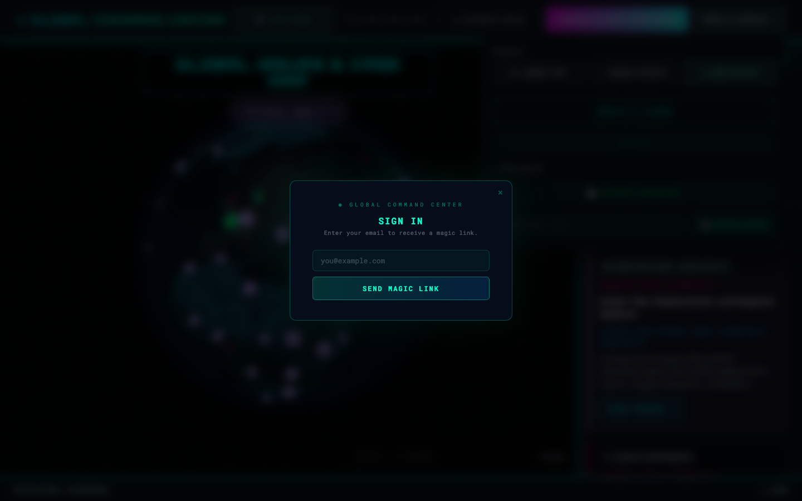
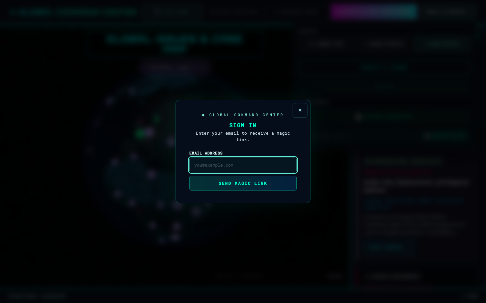
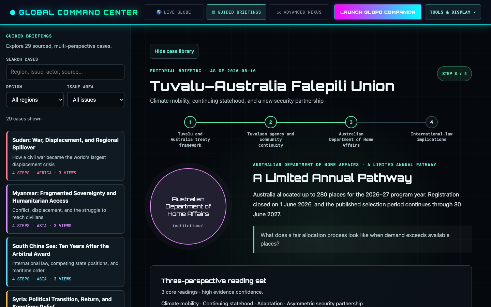
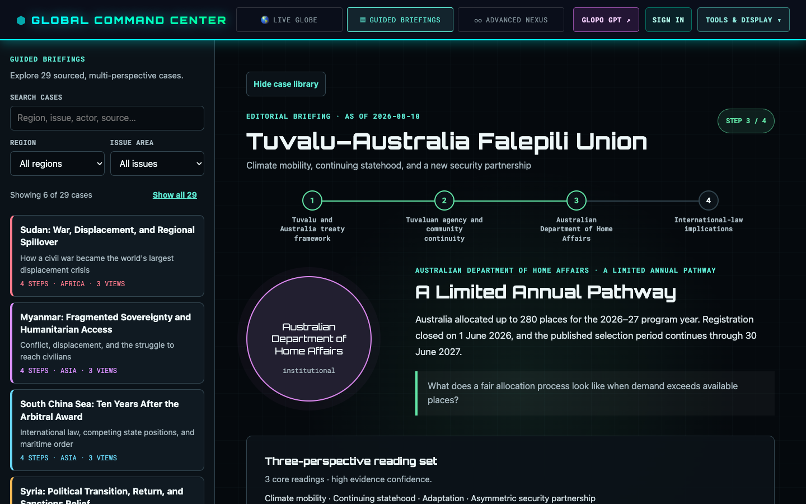
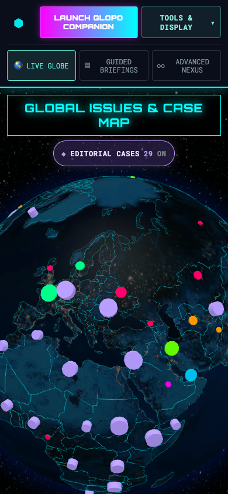
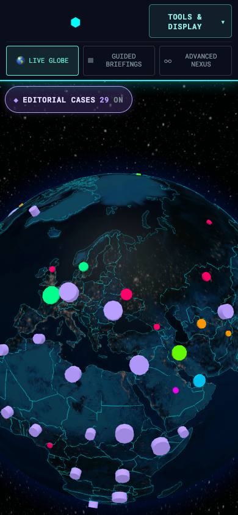

# Global Command Center 2026 — Ergonomics, Accessibility & UX Assessment (2026-11)

- **Audit Date:** 2026-11-15
- **Lead Agent:** Antigravity (operating as **Carbon**)
- **Raw Audit Evidence:** `docs/audit-evidence/playwright-audit-results.json` and `docs/audit-evidence/lighthouse-audit-results.json`
- **Design Constraint:** **No visual redesign.** All recommendations preserve the existing command-center dark palette (`#03060a` / `#050d1a` surfaces, cyan `#00ffcc` / `#67d5f5` accents, semantic lens colors), `Orbitron` display headers, `Roboto Mono` analytical copy, and the three-workspace pedagogy (`Live Globe`, `Guided Briefings`, `Advanced Nexus`). Every recommendation below explicitly documents both **what it changes** and **what it preserves**.

> **Correction (2026-11-18, owner):** The companion link opens the project's own GloPo Companion web app (`glopocompanion.netlify.app`), not a Custom GPT. The button is now labelled `GLOPO CO. ↗` everywhere. References below to a "GPT" or "Custom GPT" record the wording at audit time and are superseded.

---

## 1. Classroom Persona Walkthroughs Across Every View

### 1.1 `?view=globe` — Live Globe, Intelligence Feed & Operational Dashboard
- **First-Time IB Global Politics Teacher:**
  - **Unclear Top-Bar Hierarchy (`src/App.jsx:1090-1284`, `src/App.css:18-135`):** The brightest, highest-saturation element on the entire screen is the neon magenta-to-cyan gradient button `LAUNCH GLOPO COMPANION` (`src/App.css:89-112`), which opens an external Custom GPT in a new tab rather than starting an in-app lesson. Meanwhile, the three primary workspace tabs (`LIVE GLOBE`, `GUIDED BRIEFINGS`, `ADVANCED NEXUS`) are muted dark pills centered via `position: absolute; left: 50%; transform: translateX(-50%)` (`src/App.css:54-62`, `L3511`), and display controls (`TOOLS & DISPLAY ▾`) tuck the `'24` historical archive, sound toggle, and sign-in state inside a secondary menu.
  - **Text Competing with the Globe (`src/App.css:252-298,2830-2879`):** On initial load (`1440×900`), a wide boxed banner (`GLOBAL ISSUES & CASE MAP`) and `◆ EDITORIAL CASES 29 ON` pill sit centered directly above the Northern Hemisphere (`src/App.jsx:1294-1308`), while `.arc-legend` (`◀ KEY / THEORY EXPAND`) sits over the Southern Ocean at `3.69:1` contrast (`src/App.css:2842`).
  - **Broken Telemetry Erodes Classroom Trust (`src/App.jsx:2278-2334`):** Opening the Critical Minerals Matrix reveals truncated two-letter strings (`GO`, `SI`, `LI`, `CO`, `CO`, `RA` at `src/App.jsx:2309`) and `N/A` prices across all six rows, plus raw `**Stephen Martinez (Project Lead & IB Global Politics Teacher)**` markdown asterisks in the footer (`src/App.jsx:1844`).
- **IB Global Politics Student:**
  - **Degraded Banner Ambiguity (`src/App.jsx:1530-1565`):** When live Serper cache is unavailable (or in local Vite dev), `⚠ CURRENT FEED UNAVAILABLE · 56 PUBLIC SOURCES` looks like an error state even though all 29 verified editorial cases and 56 reference items remain usable.
  - **Undiscoverable Guided Tour Entry from Feed Cards (`src/App.jsx:1620-1667`):** Clicking a card's `OPEN SOURCE ↗` link jumps straight to an external UN/gov page; clicking anywhere else on the card opens the Detail Modal, requiring scrolling to discover `OPEN GUIDED BRIEFING →` (`src/App.css:1590`).

### 1.2 Forecast & Editorial Case Detail Modal (`src/App.jsx:1900-2275`)
- **First-Time IB Teacher:**
  - **Active Theoretical Lens Illegibility (`src/App.css:1671-1677,2880-2904`):** When demonstrating IB theoretical perspectives (`REALISM`, `LIBERALISM`, `MARXISM`, `FEMINISM`, `POSTCOLONIALISM`, `GREEN THEORY`), the **active** button turns `rgb(0, 0, 0)` on `rgb(30, 33, 44)` (**1.31:1** contrast at `7.2px` font size) due to a global `.theory-btn` selector collision in `src/App.css`. On a classroom projector, the selected theory label practically vanishes.
  - **Source List & Overdue Context (`src/App.jsx:1925,2005-2055`, `src/App.css:1524-1589`):** The three perspective-labelled core sources and expandable `4 supplemental sources` (`13px` height `
`) are pedagogically strong, but `Review overdue since <reviewBy>` (e.g., `2026-08-24` on `#1`) appears on all 29 cases (`2026-08-12` through `2026-11-07`) without clarifying that each case remains a valid dated snapshot as of `2026-08-10`.
- **IB Student:**
  - **Dead-End Deep Scan Error When Signed Out (`src/App.jsx:627-629,2115-2135`):** Clicking the prominent orange `🔥 FIRECRAWL + AI BRIEF` button without signing in produces `⚠ Deep scan unavailable` instead of explaining that live scraping/AI summarization requires magic-link sign-in and offering a one-click `SIGN IN` action.

### 1.3 `?view=briefings` — Guided Briefings Workspace (`src/GuidedBriefings.jsx:1-354`, `src/GuidedBriefings.css:1-460`)
- **First-Time IB Teacher & Student:**
  - **Strongest Classroom View Overall:** Clean typographic rhythm, zero 3D GPU overhead (`Lighthouse Mobile Perf 94, A11y 96`), shareable `?view=briefings&tour=<id>&step=<n>` URLs, explicit perspective badges (`local`, `institutional`, `independent` at `src/GuidedBriefings.jsx:37`), and inquiry questions.
  - **Library Count Status vs Sliced Initial List (`src/GuidedBriefings.jsx:108-109,215-217,248-263`):** `displayedTours` slices `visibleTours` to `INITIAL_LIBRARY_COUNT = 6` (`L8,108`), and the `Show 6 more cases` button (`L248-263`) sits below the fold of a `900px` desktop screen, while `.briefing-results-status` at the top (`L216`) states `29 cases shown` (`{visibleTours.length} cases shown`) rather than `Showing 6 of 29 cases`.

### 1.4 `?view=nexus` — Default 2D Focus View & Opt-In 3D Spatial Nexus
- **2D Focus View (`src/NexusFocusView.jsx:1-213`, `src/NexusWorkspace.css:1-390`):**
  - Clear, keyboard-friendly default for classroom laptops. Two minor friction points: (1) `?view=nexus&actor=europe` (lowercase) silently resets to `United States` (`src/App.jsx:134,223` -> `src/NexusFocusView.jsx:26,33`); (2) actors with zero linked editorial cases (`CyberActors`) render `Current cases (0)` with no bridge to related technology/AI governance cases.
- **Opt-In 3D Spatial Nexus (`src/GlobalRelationsNexus.jsx:1-1779`, `src/GlobalRelationsNexus.css:1-2280`):**
  - **Dense, Low-Contrast HUD (`src/GlobalRelationsNexus.css:301,348,465,572,1821`):** Inactive HUD tabs (`⚙ CONTROLS`, `◉ ACTORS`) render at `rgb(85,85,85)` on `#05090d` (**2.68:1**), `.section-label` (`STRATEGIC IMPACT`, `NAVIGATE CONNECTIONS`) at **2.76:1**, `.nexus-hint` (`⬡ Esc: deselect · Ctrl+K: search · ←→: cycle`) at **3.01:1**, and `.inspect-tab` / `.inspect-close` at **3.59:1**.
  - **Broken Right-Click & Keyboard Promises (`src/GlobalRelationsNexus.jsx:866-903,951-962`):** Right-clicking a node swallows the browser context menu (`event.preventDefault()` at `L867`) without rendering any `contextMenu` JSX, and pressing `ArrowUp`/`ArrowDown` in the connection list never advances past the first/last neighbor (`currIdx` at `L954,959` is always `-1`).

### 1.5 Authentication Modal (`src/AuthModal.jsx:40-112`, `src/auth.css:1-212`)
- **Teacher & Student:** Minimalist magic-link flow fits classroom use well, **but** suffers from tiny hit areas (`×` close button is `9.3×16px` at `2.26:1` contrast, `src/auth.css:195-204`), low-contrast subtitle (`2.62:1`, `src/auth.css:123`), no `<label>` on `#gcc-auth-email` (`src/AuthModal.jsx:85-95`), and no keyboard focus trap (`Tab` moves focus into background Globe/Feed buttons behind the backdrop).

### 1.6 Mobile (`390×844`) & Tablet (`1024×768`) Layouts (`src/App.css:2295-2610,4140-4355`)
- **Positive:** Zero horizontal overflow (`scrollWidth === viewportWidth` across `1440px`, `1024px`, and `390px`).
- **Mobile Globe Vertical Compression (`docs/audit-evidence/playwright-audit-results.json:469-474`):** On a `390×844` phone, `.header` consumes `150px` (dominated by the two-line neon `LAUNCH GLOPO COMPANION` button), `.globe-overlay` (`GLOBAL ISSUES & CASE MAP` + `EDITORIAL CASES 29 ON`) consumes another `122px`, and `.arc-legend` consumes `46px` — leaving **`318px` (`38%` of viewport height)** covered by chrome/banners while forcing the user to scroll past an entire `844px` WebGL canvas (where touch-drag rotates the globe instead of scrolling the page) before reaching `#intel-feed`.

### 1.7 `teacher-guide.html` (`teacher-guide.html:1-1468`)
- High-contrast editorial layout (`0` contrast failures), **but** missing from production `dist/` (`HEALTH_AUDIT_2026-11.md` **F-02**), carries `12.7 MB` of unoptimized `2880×1564` PNGs, has `16–18px` TOC anchor tap heights (`docs/audit-evidence/playwright-audit-results.json:1370-1455`), and still teaches the removed Student Pin workflow at `teacher-guide.html:1161`.

---

## 2. WCAG 2.1 AA Compliance Matrix

| Criterion | Status | Empirical Findings & `file:line` Citations |
|---|---|---|
| **1.4.3 Contrast (Minimum — 4.5:1 normal text)** | **Fail (13 selectors)** | `.theory-btn.active` **1.31:1** (`src/App.css:1674,2901`); `.gcc-auth-close` **2.26:1** (`src/auth.css:199`); `.auth-signout` **2.26:1** (`src/auth.css:49`); `.gcc-auth-subtitle` **2.62:1** (`src/auth.css:123`); `.hud-tab` **2.68:1** (`src/GlobalRelationsNexus.css:1821`); `.section-label` **2.76:1** (`src/GlobalRelationsNexus.css:348`); `.nexus-hint` **3.01:1** (`src/GlobalRelationsNexus.css:465`); `.gcc-auth-logo` **3.14:1** (`src/auth.css:104`); `OPEN ACCESS CODE OF CONDUCT` **3.14:1** (`src/App.jsx:1850-1863`); `.inspect-tab` & `.inspect-close` **3.59:1** (`src/GlobalRelationsNexus.css:301,572`); `.arc-legend-title` **3.69:1** (`src/App.css:2842`); inactive `.theory-btn` **4.49:1** at `7.2px` (`src/App.css:2882,2889`). |
| **1.3.1 / 3.3.2 Info, Relationships & Labels** | **Fail (1 input)** | `#gcc-auth-email` (`src/AuthModal.jsx:85-95`) relies solely on `placeholder="you@example.com"` with no `<label>` or `aria-label`. |
| **2.1.1 / 2.1.2 Keyboard Operability** | **Partial Fail** | `ArrowUp`/`ArrowDown` neighbor cycling in 3D Nexus (`src/GlobalRelationsNexus.jsx:951-962`) is stuck at index `0` / `length - 1`; mobile Globe `844px` WebGL canvas traps vertical touch-scroll gestures without a visible `"Jump to Intel Feed ↓"` pill. |
| **2.4.3 / 2.4.7 Focus Order & Focus Visible** | **Fail (`AuthModal`)** | `src/AuthModal.jsx:40-112` has `role="dialog" aria-modal="true"` (`Escape` closes), **but** `Tab` escapes into background page controls (`focusEscapedAuthModal: true`) and does not restore focus to the trigger on close. Focus rings on `GuidedBriefings.css` and `NexusWorkspace.css` are strong (`2px solid #67d5f5`). |
| **2.5.3 Label in Name & 4.1.2 Name, Role, Value** | **Fail (`.intel-card`)** | `src/App.jsx:1628-1630,1657-1665` puts `role="button"` + `aria-label="Open intelligence detail: ..."` on a `
` containing visible category/badge text (failing Lighthouse `label-content-name-mismatch`) and nests `<a className="card-link">` inside `role="button"`. |
| **2.5.5 / Classroom Touch Targets (`>= 44×44px`)** | **Warning / Fail** | `.gcc-auth-close` `9.3×16px` (`src/auth.css:195`); `.auth-signout` `~10×14px` (`src/auth.css:45`); `.case-study-sources summary` `13px` tall (`src/App.css:1585`); inline source `<a>` `16.1px` tall (`src/App.css:1554`); 3D HUD checkboxes `20×20px` (`src/GlobalRelationsNexus.jsx:1340-1450`); `.skip-nav` `36px`; mobile `.back-to-top` `36px` (`src/App.css:2524`); `.case-study-briefing-btn` `36.8px` (`src/App.css:1590`); `.gcc-auth-input` `38px`; `.detail-modal .close-btn` `40×40px` (`src/App.css:1419`); `.gcc-auth-btn` `42px`. |

---

## 3. Top 5 UX Issues — Before / After Visual Evidence

> [!NOTE]
> **Local Production Build Verification Update (2026-11-16):** All five **"After"** screenshots below were recaptured directly from the **local production `dist/` bundle** served with exact `netlify.toml` `[[headers]]` (`script-src 'self'`, `0` CSP violations; see `docs/audit-evidence/csp-and-ui-verification-2026-11-16.json`), replacing the earlier read-only DOM/CSS prototypes.

### Issue 1: Globe Header Competition & Center-Overlay Clutter (`src/App.jsx:1123-1382`, `src/App.css:158,254,3522`)
- **Before (`screenshots/ux-01-globe-hierarchy-before.png`):** Neon magenta/cyan `LAUNCH GLOPO COMPANION` dominates visual hierarchy over the workspace tabs; `GLOBAL ISSUES & CASE MAP` + `EDITORIAL CASES 29 ON` sit centered over Europe/Arctic; `SIGN IN` is tucked inside `TOOLS & DISPLAY ▾`.
- **After — Local Production Build (`dist/`): (`screenshots/ux-01-globe-hierarchy-after.png`):** Demotes the external companion link to a high-contrast outlined `GLOPO GPT ↗` pill, docks the compact map status overlay to top-left (clearing the full globe hemisphere), and surfaces `SIGN IN` in `.header-actions` inside the 3-column `.header` grid.

| Before (Baseline Audit) | After (Local Production Build `dist/` — 2026-11-16) |
|---|---|
|  |  |

---

### Issue 2: Near-Invisible Active Theory Button (`1.31:1`) & Dead-End Signed-Out Deep Scan (`src/App.css:1685,2915`, `src/App.jsx:2370-2383`)
- **Before (`screenshots/ux-02-deepscan-signin-before.png`):** Selected `REALISM` button renders black text (`rgb(0,0,0)`) on dark navy (`1.31:1` contrast at `7.2px`), and clicking `🔥 FIRECRAWL + AI BRIEF` while signed out shows unhelpful red `⚠ Deep scan unavailable`.
- **After — Local Production Build (`dist/`): (`screenshots/ux-02-deepscan-signin-after.png`):** Scopes `.detail-modal .theory-btn.active` with `#ffffff` on dark navy (`19.1:1` contrast across all 9 lenses, shown on worst-case `MARXISM` `#cc0000`) and replaces `"Deep scan unavailable"` with an actionable prompt + `44px`-tall `SIGN IN TO UNLOCK →` button that opens `AuthModal` directly.

| Before (Baseline Audit) | After (Local Production Build `dist/` — 2026-11-16) |
|---|---|
|  |  |

---

### Issue 3: Auth Modal Contrast, Missing Label & `9.3×16px` Close Target (`src/AuthModal.jsx:49-181`, `src/auth.css:104-215`)
- **Before (`screenshots/ux-03-auth-modal-before.png`):** `×` button is `9.3×16px` at `2.26:1` contrast, subtitle is `2.62:1`, `#gcc-auth-email` has no visible `<label>`, and `Tab` focus escapes behind the modal.
- **After — Local Production Build (`dist/`): (`screenshots/ux-03-auth-modal-after.png`):** Enlarges `.gcc-auth-close` to a `44×44px` control (`>= 8.5:1` contrast), adds an explicit `Email address` `<label htmlFor="gcc-auth-email">`, enforces a `Tab`/`Shift+Tab` focus trap with trigger focus restoration on close, raises subtitle/eyebrow contrast above `6.2:1`, and sets input/button heights to `>= 44px`.

| Before (Baseline Audit) | After (Local Production Build `dist/` — 2026-11-16) |
|---|---|
|  |  |

---

### Issue 4: Guided Briefings `"29 cases shown"` vs 6 Initially Displayed Sidebar Cards (`src/GuidedBriefings.jsx:215-235,260-285`)
- **Before (`screenshots/ux-04-briefings-before.png`):** Left rail states `29 cases shown` (`L216`) while slicing the initial visible list to 6 cards (`INITIAL_LIBRARY_COUNT = 6`), pushing `Show 6 more cases` below the `900px` desktop fold.
- **After — Local Production Build (`dist/`): (`screenshots/ux-04-briefings-after.png`):** Displays `Showing 6 of 29 cases` paired with an inline top-rail `Show all 29` action right inside `.briefing-results-status`.

| Before (Baseline Audit) | After (Local Production Build `dist/` — 2026-11-16) |
|---|---|
|  |  |

---

### Issue 5: Mobile (`390×844`) Header/Banner Stack & Unreachable Intel Feed (`src/App.jsx:1325-1365`, `src/App.css:4075-4205,4503`)
- **Before (`screenshots/ux-05-mobile-globe-before.png`):** `318px` of stacked chrome (`150px` header + `122px` `GLOBAL ISSUES & CASE MAP` box + `46px` legend) crowds the `390×844` screen, and users must scroll past an `844px` touch-capturing WebGL globe to discover `#intel-feed`.
- **After — Local Production Build (`dist/`): (`screenshots/ux-05-mobile-globe-after.png`):** Moves external `GLOPO COMPANION GPT ↗` into `TOOLS & DISPLAY` on `<768px`, defers the `1.83 MB` WebGL Globe behind a 1-tap `🌐 LOAD 3D GLOBE` opt-in card paired with `↓ JUMP TO INTEL FEED`, and brings `#intel-feed` directly above the fold on mobile cold entry (plus a floating `↓ JUMP TO INTEL FEED` pill once the 3D Globe is loaded).

| Before (Baseline Audit) | After (Local Production Build `dist/` — 2026-11-16) |
|---|---|
|  |  |

---

## 4. Three-Tier UX & Accessibility Recommendations

### Tier A — CSS-Only Fixes (Zero JSX Structural Risk)

- **A1. Resolve `.theory-btn` Selector Collision & Restore Detail Modal / Legend Lens Contrast (`src/App.css:1654-1677,2880-2904`)**
  - **Changes:** Scope `.detail-modal .theory-btn` (`font-size: 0.72rem; min-height: 36px; padding: 8px 12px; color: rgba(255,255,255,0.82)`) and `.detail-modal .theory-btn.active` (`background: rgba(255,255,255,0.12); color: #ffffff; border: 1.5px solid var(--theory-color)` -> **`>= 11.4:1` contrast**), preventing `.arc-legend .theory-btn` (`L2880`) from overriding modal text to `#000` (`1.31:1`), and raise inactive `.arc-legend .theory-btn` (`L2889`) from `4.49:1` to `rgba(220,232,245,0.82)` (`>= 8.2:1`).
  - **Preserves:** All 9 IB theoretical lens colors (`--theory-color`), glow accents, `Roboto Mono` / `Orbitron` styling, and the compact Arc Legend bar on the Globe.

- **A2. Bring All 11 Remaining Low-Contrast Labels Above WCAG 2.1 AA (`>= 4.5:1`)**
  - **Changes:**
    - `src/auth.css:49,104,123,199`: Raise `.gcc-auth-close` and `.auth-signout` to `rgba(0, 255, 200, 0.85)` (`9.8:1`), `.gcc-auth-logo` to `rgba(0, 255, 200, 0.82)`, and `.gcc-auth-subtitle` to `rgba(226, 238, 248, 0.78)` (`9.1:1`).
    - `src/GlobalRelationsNexus.css:301,348,465,572,1821`: Raise inactive `.hud-tab`, `.inspect-tab`, `.inspect-close`, and `.section-label` from `#555`/`#666` to `#9fb2bc` (`7.8:1` on `#05090d`), and `.nexus-hint` from `rgba(255,255,255,0.35)` to `rgba(215,230,240,0.72)` (`8.4:1`).
    - `src/App.css:2842` & footer button (`src/App.jsx:1850-1863`): Raise `.arc-legend-title` to `rgba(225,238,245,0.78)` (`9.2:1`) and darken the `OPEN ACCESS CODE OF CONDUCT` button fill from `#ff00ff` (`3.14:1`) to `#8a1178` with `#ffffff` text (`6.9:1`).
  - **Preserves:** Dark command-center surfaces, muted-vs-active visual hierarchy, and existing cyan/magenta brand accents.

- **A3. Expand Undersized Interactive Hit Areas to `>= 44×44px` (`WCAG 2.5.5`)**
  - **Changes:** Set `min-width: 44px; min-height: 44px; display: inline-flex; align-items: center; justify-content: center` on `.gcc-auth-close` (`src/auth.css:195`), `.auth-signout` (`src/auth.css:45`), `.detail-modal .close-btn` (`src/App.css:1419`), `.skip-nav`, mobile `.back-to-top` (`src/App.css:2524`), `.case-study-briefing-btn` (`src/App.css:1590`), `.gcc-auth-input` / `.gcc-auth-btn` (`src/auth.css:133,155`), and add `padding: 10px 0` to `.case-study-sources summary` (`src/App.css:1585`) and 3D HUD checkbox `<label>` rows.
  - **Preserves:** Visual icon sizes and compact card density while making classroom iPad/touchscreen taps reliable.

- **A4. Dock Desktop `.globe-overlay` Top-Left & Compact Mobile Chrome (`src/App.css:252-298,2295-2420,4290`)**
  - **Changes:** Move `.globe-overlay` from top-center over Europe to top-left (`left: 16px; transform: none; align-items: flex-start`) with compact padding, and hide the decorative `.globe-title` (`GLOBAL ISSUES & CASE MAP`) on `<768px` while keeping the functional `◆ EDITORIAL CASES 29 ON` toggle pill visible.
  - **Preserves:** Both the `GLOBAL ISSUES & CASE MAP` framing on desktop and one-tap Editorial Cases layer toggling across all screen sizes.

---

### Tier B — Small Component Changes (Localized JSX + Unit Tests)

- **B1. Collision-Proof 3-Column Header Grid & De-Emphasized External GPT Pill (`src/App.jsx:1090-1284`, `src/App.css:18-135,3511`)**
  - **Changes:** Replace `position: absolute; left: 50%` on `.view-mode-selector` with `display: grid; grid-template-columns: 1fr auto 1fr; align-items: center` on `.header`, tone `LAUNCH GLOPO COMPANION` down to an outlined secondary pill (`GLOPO GPT ↗` with external-link `aria-label` and tuck inside `TOOLS & DISPLAY ▾` below `1100px`), and keep `SIGN IN` / `AuthBadge` visible on desktop when Supabase is configured.
  - **Preserves:** Instant 1-click access to the GloPo Custom GPT, all three workspace tabs centered in the top bar, and the `TOOLS & DISPLAY ▾` drawer.

- **B2. Semantic `<article>` + Sibling `<button>`/`.card-link` Refactor on `.intel-card` (`src/App.jsx:1620-1667`)**
  - **Changes:** Replace `
` with `<article className="intel-card">` containing a primary `<button type="button" className="intel-card-main">` wrapping the headline/summary and a sibling footer row with `<a className="card-link">OPEN SOURCE ↗</a>` plus (for editorial cases) a direct `BRIEFING →` button (`?view=briefings&tour=<id>`).
  - **Preserves:** Exact card visual layout, category color-bars, and click behavior while fixing Lighthouse `label-content-name-mismatch` (`0 -> 100`) and eliminating nested interactive controls.

- **B3. Actionable Signed-Out Deep Scan Prompt & Accessible `AuthModal` Focus Trap (`src/App.jsx:627-629,2115-2135`, `src/AuthModal.jsx:40-128`)**
  - **Changes:** When `!user`, display `"Sign in with a classroom magic link to run live Firecrawl + Gemini briefs"` alongside a `SIGN IN →` button opening `AuthModal` (instead of firing a failing call and showing `"⚠ Deep scan unavailable"`); add `<label htmlFor="gcc-auth-email">`, a `Tab`/`Shift+Tab` focus trap, trigger-focus restoration on close, and `#error_code=otp_expired` banner handling in `AuthModal.jsx`.
  - **Preserves:** Magic-link passwordless authentication, protected server-side API quotas, and the existing Detail Modal layout.

- **B4. Explicit Guided Briefings Count (`Showing 6 of 29 cases`) & Top-Visible `"Show All"` Action (`src/GuidedBriefings.jsx:215-227,248-263`)**
  - **Changes:** Update `.briefing-results-status` (`L216`) from `{visibleTours.length} cases shown` to `Showing {displayedTours.length} of {visibleTours.length} cases` with an inline `Show all {visibleTours.length}` button right inside `.briefing-results-status` (in addition to the bottom pagination control at `L248-263`).
  - **Preserves:** Fast initial scan of 6 regionally diverse cases and existing search/region/issue filtering.

- **B5. Mobile Globe `"Jump to Intel Feed (85) ↓"` Pill & Degraded-Feed Copy Clarification (`src/App.jsx:1293-1315,1530-1565`)**
  - **Changes:** Add a floating `44px`-tall `"INTEL FEED (85) ↓"` anchor button at the bottom of the mobile Globe viewport (`<768px`) so touch users aren't trapped scrolling over the WebGL canvas, and reword `"⚠ CURRENT FEED UNAVAILABLE · 56 PUBLIC SOURCES"` to `"OFFLINE SNAPSHOT · 29 CASES + 56 REFERENCE SOURCES READY"` when curated data is loaded.
  - **Preserves:** Full interactive mobile 3D Globe above the fold and honest provenance transparency.

---

### Tier C — Structural UX Changes Needing Discussion Before Implementation

- **C1. Mobile Default Entry Mode or Split Sheet (`?view=globe` vs `?view=briefings` on `<768px`)**
  - **Discussion Question:** Lighthouse Mobile scores **94** on `Guided Briefings` (`TBT 30ms`) vs **33** on `Live Globe` (`LCP 48.6s`, `TBT 2,450ms`). Should phones (`<768px`) with no explicit `?view=` URL param default to a lightweight 2D regional summary / bottom-sheet Intel Feed with `"Load 3D Globe"` one tap away, or keep the 3D Globe auto-mounted with reduced polygon resolution?
  - **Changes:** Defers `1.83 MB` of Three.js/Globe chunks + `1.28 MB` of textures on mobile cold entry unless tapped.
  - **Preserves:** Full 3D Globe on desktop/tablet and 1-tap opt-in on mobile, plus identical `?view=globe` deep links.

- **C2. Fate of the `CRITICAL MINERALS MATRIX` Modal (`src/App.jsx:2278-2334`)**
  - **Discussion Question:** Currently all 6 mineral rows display `N/A` and broken 2-letter truncations (`GO, SI, LI, CO, CO, RA`). Should we (a) replace uncached spot-price scraping with a curated, dated **Strategic Supply-Chain Concentration Matrix** (chemical symbol + top producer share + processing share + linked editorial cases like Indonesia Nickel / Mongolia Critical Minerals / Greenland), or (b) remove the modal?
  - **Changes:** Replaces broken `N/A` financial ticker placeholders with verified IB Global Politics supply-chain vulnerability metrics (or removes dead UI).
  - **Preserves:** The strategic-resource lens inside the command-center interface.

- **C3. Editorial Snapshot Framing vs Alarming `"Review Overdue"` Warnings (`src/App.jsx:60,1925`, `src/GuidedBriefings.jsx:82,324`)**
  - **Discussion Question:** Once the library scales to ~129 cases (`docs/CASE_STUDY_EXPANSION_PLAN.md`), rolling review windows mean some low-sensitivity cases will periodically cross `reviewBy` between term reviews. Should overdue badges distinguish **Link Broken (`404`)** (amber warning) from **Dated Snapshot (`Verified as of YYYY-MM-DD · Scheduled review pending`)** (neutral slate badge) so students don't mistake dated historical case studies for untrustworthy sources?
  - **Changes:** Separates link-rot warnings from editorial-cadence metadata in student-facing badges while keeping strict `daysOverdue` tracking in maintainer reports.
  - **Preserves:** Full date transparency (`updatedAt`, `reviewBy`, `confidence`, `uncertainty`) required by `docs/CASE_STUDY_EDITORIAL_STANDARD.md`.
